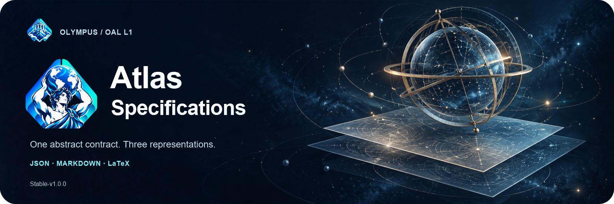
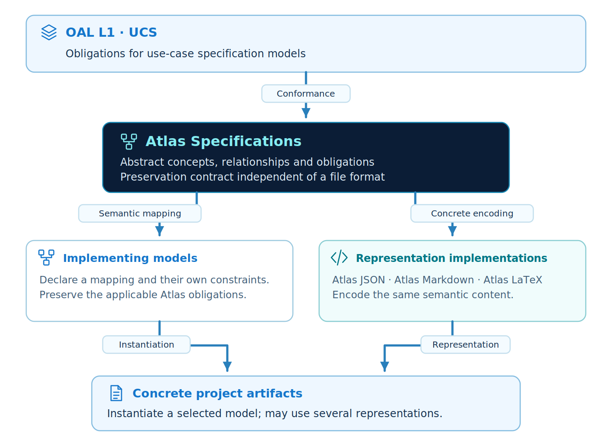
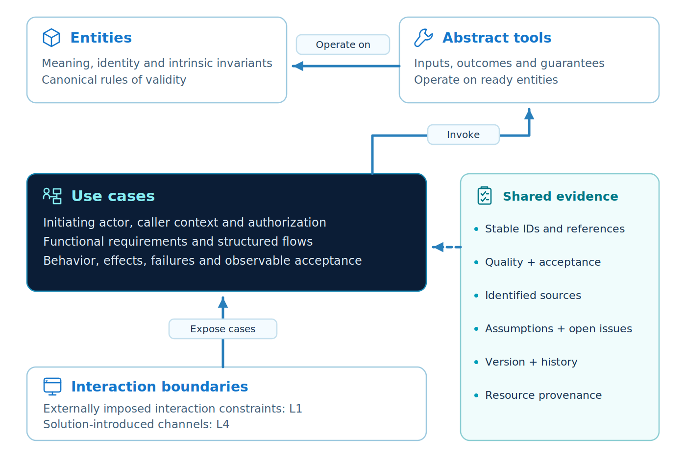
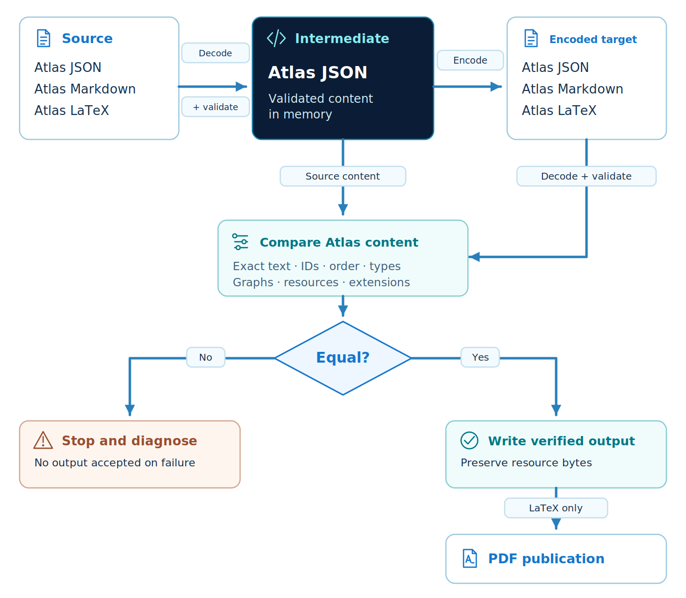

<p align="center"></p>

<p align="center"><strong>Atlas Specifications Stable-v1.0.0 · OAL L1 / UCS</strong></p>

English · [Português brasileiro](README.pt-br.md)

# Atlas Specifications

**Atlas Specifications is an abstract model for writing use-case specifications at OAL L1 (UCS).** It connects scope, actors and permissions, entities and rules, behavioral contracts, dependencies, acceptance criteria, and the evidence behind each statement. Other models can implement or specialize Atlas through an explicit mapping of its concepts and obligations.

Part of the **Olympus** ecosystem, Atlas supplies **Atlas JSON**, **Atlas Markdown**, and **Atlas LaTeX**: three representations of the same specification. A Python translator validates and converts their content; LaTeX can then produce a PDF for reading and sharing. The project includes matching starters, complete examples, and a portable skill for AI agents.

This README is the illustrated introduction. The [edition manual](versioning/Stable-v1.0.0/README.md) contains the detailed textual rules and contracts. English is normative; Portuguese is its translation.

Stable is prepared for review; publication is pending. The OAL baseline was delivered locally and is pinned with its original bytes in the [edition correspondence](versioning/Stable-v1.0.0/README.md#oal-conformance).

## Contents

- [Atlas and OAL](#atlas-and-oal)
- [Specification content](#specification-content)
- [Representations and translation](#translation)
- [Quick start](#quick-start)
- [Versions](#versions)
- [AI skill](#ai-skill)
- [Examples](#examples)
- [Repository organization](#repository-organization)
- [Frequently asked questions](#faq)
- [Authorship and license](#authorship)

<a id="atlas-and-oal"></a>
## Atlas and OAL

<p align="center"></p>

[OAL — Open Analysis Layers](https://github.com/CodeVaultCommunity/OAL-Open-Analysis-Layers) defines responsibilities for reusable models at each development layer. Atlas uses **OAL Stable-v1.0.0** as its reference for **L1 · Use Case Specification**, making intended behavior explicit before selecting code organization and interaction mechanisms.

The diagram distinguishes the OAL metamodel, the Atlas abstract model, models implementing that abstraction, and concrete project artifacts. A project specification can have several file representations without becoming several models. An implementing model declares how it preserves Atlas concepts and invariants.

Atlas covers the declared L1 scope. It does not provide later OAL layers or a cross-layer derivation engine. The [conformance guide](versioning/Stable-v1.0.0/README.md#conformance) identifies the baseline, mapping, evidence, and limits.

<a id="specification-content"></a>
## Specification content

<p align="center"></p>

A specification connects concepts through stable identities and explicit references. Shared rules have one authoritative definition. A case states what must happen, under which conditions, for which actors, and with which results and failures.

| Part | What it records |
| --- | --- |
| **Context and actors** | Objectives, scope, vocabulary, roles, and authorization context. |
| **Entities and rules** | Data, relationships, valid states, canonical validations, and rule ownership. |
| **Abstract tools** | Required capabilities, inputs, outcomes, effects, and guarantees without prescribing mechanisms. |
| **Use cases** | Triggers, permissions, conditions, requirements, dependencies, flows, and acceptance criteria. |
| **Boundaries and resources** | Classified external restrictions, references or illustrations, graphs, and catalogued files. |
| **Evidence and evolution** | Sources, facts, desired requirements, assumptions, decisions, open issues, revisions, and traceability. |

The [reference rules](versioning/Stable-v1.0.0/README.md#reference-rules) explain these obligations in detail. They distinguish confirmed information from assumptions and keep solution-specific interaction choices separate from externally imposed requirements.

<a id="translation"></a>
## Representations and translation

| Representation | Typical use | Starting point |
| --- | --- | --- |
| **Atlas JSON** | Structured authoring, validation, and automation. | [Schema and guide](versioning/Stable-v1.0.0/implementations/json/README.md) · [Starter](versioning/Stable-v1.0.0/implementations/json/starter.atlas.json) |
| **Atlas Markdown** | Reading and reviewing specifications in a repository. | [Profile guide](versioning/Stable-v1.0.0/implementations/markdown/README.md) · [Starter](versioning/Stable-v1.0.0/implementations/markdown/starter.atlas.md) |
| **Atlas LaTeX** | Typesetting and PDF publication. | [Profile guide](versioning/Stable-v1.0.0/implementations/latex/README.md) · [Starter](versioning/Stable-v1.0.0/implementations/latex/starter.atlas.tex) |

A **schema** checks structure; a **starter** is a document to copy and complete; an **example** demonstrates populated contracts. The three starters carry equivalent draft content. Markdown and LaTeX follow controlled profiles with authoritative text records and structural appendices, so arbitrary `.md` and `.tex` documents are not automatically Atlas instances.

<p align="center"></p>

The translator supports all **six directions between the three profiles**. It decodes and validates the source, produces the target, then decodes that output and compares the complete recovered `atlas` content before writing. Markdown ↔ LaTeX uses validated JSON content in memory as the intermediate representation.

Preservation concerns authored text, structure, identities, references, and supported extension data, not identical file bytes or page layout. Resources use the separate packaging contract. PDF is a compiled publication and is not accepted as reversible input. See the [detailed translation rules](versioning/Stable-v1.0.0/README.md#translation) and [CLI guide](versioning/Stable-v1.0.0/translator/README.md).

<a id="quick-start"></a>
## Quick start

Use **Python 3.11 or later**. After extracting the repository, run from its root:

```bash
cd versioning/Stable-v1.0.0
python -m venv .venv
# POSIX: source .venv/bin/activate
# PowerShell: .venv\Scripts\Activate.ps1
python -m pip install .
python translator/atlas_translate.py formats
python translator/atlas_translate.py validate implementations/json/starter.atlas.json
python translator/atlas_translate.py convert implementations/json/starter.atlas.json --from json --to markdown -o work/specification.atlas.md
```

The last command creates a Markdown draft in `work/`. For structured authoring, copy the JSON starter into your working folder, replace its identity and authorship, and fill it from actual needs before validating and converting. The installed `atlas-spec` command exposes the same interface.

A starter is a valid draft shell with empty domain collections and explicit unanswered questions. Passing validation does not establish a complete or approved specification. Follow the [detailed setup](versioning/Stable-v1.0.0/README.md#quick-start) for authoring, resources, and publication, and the [verification guide](versioning/Stable-v1.0.0/README.md#verification) for tests.

<a id="versions"></a>
## Versions

| Edition | Status | Release Notes | Reference rules | Verification Guide | Conformance Guide |
| --- | --- | --- | --- | --- | --- |
| Stable-v1.0.0 | Stable candidate · publication pending | [English](versioning/Stable-v1.0.0/README.md#release-notes) · [Português](versioning/Stable-v1.0.0/README.pt-br.md#release-notes) | [English](versioning/Stable-v1.0.0/README.md#reference-rules) · [Português](versioning/Stable-v1.0.0/README.pt-br.md#reference-rules) | [English](versioning/Stable-v1.0.0/README.md#verification) · [Português](versioning/Stable-v1.0.0/README.pt-br.md#verification) | [English](versioning/Stable-v1.0.0/README.md#conformance) · [Português](versioning/Stable-v1.0.0/README.pt-br.md#conformance) |
| Alpha-v0.1.0 | Historical · preserved | [English](versioning/Alpha-v0.1.0/README.md#release-notes) · [Português](versioning/Alpha-v0.1.0/README.pt-br.md#release-notes) | [English](versioning/Alpha-v0.1.0/README.md#reference-rules) · [Português](versioning/Alpha-v0.1.0/README.pt-br.md#reference-rules) | [English](versioning/Alpha-v0.1.0/README.md#verification) · [Português](versioning/Alpha-v0.1.0/README.pt-br.md#verification) | [English](versioning/Alpha-v0.1.0/README.md#conformance) · [Português](versioning/Alpha-v0.1.0/README.pt-br.md#conformance) |

The edition keeps its own translator, dependencies, tests, examples, and skill. The [versioning guide](versioning/Stable-v1.0.0/README.md#versioning) distinguishes model/profile and package versions from a document's revision. Conversion preserves those identities; it is not a migration.

<a id="ai-skill"></a>
## AI skill

The portable [Atlas skill](versioning/Stable-v1.0.0/skills/atlas-specs/SKILL.md) supports **create/revise**, **read/audit**, and **convert/publish** workflows. Copy the complete `skills/atlas-specs/` folder and follow its instructions. It includes references, a starter, and the version-matched translator for independent use. Agents must distinguish supplied requirements from assumptions and unresolved questions.

For repository navigation and skill installation, read [AGENTS.md](AGENTS.md). [CLAUDE.md](CLAUDE.md) provides the corresponding entry point for Claude-based workflows.

`skills/build.py` is a maintenance helper. It synchronizes the skill after changes to canonical documentation, schemas, styles, or translator code; `--check` detects drift without writing. **Using the distributed skill does not require running the builder.** The [edition manual](versioning/Stable-v1.0.0/README.md#ai-skill) explains the generated bundle.

<a id="examples"></a>
## Examples

| Example | What to explore |
| --- | --- |
| [Minimal request](versioning/Stable-v1.0.0/examples/minimal/README.md) | One case, entity validation, permissions, and packaged illustrations. |
| [Composition](versioning/Stable-v1.0.0/examples/composition/README.md) | Booking lookup/create/cancel, composed cases, and persistence outcomes. |
| [Task board](versioning/Stable-v1.0.0/examples/task-board/README.md) | Create/complete/list tasks, conflicts, and links between synthetic needs, requirements, and acceptance criteria. |

Each includes JSON, Markdown, LaTeX, and PDF. These are didactic specifications with assumptions and proposed targets identified. The [examples guide](versioning/Stable-v1.0.0/examples/README.md) describes their sources and rebuild/check commands.

<a id="repository-organization"></a>
## Repository organization

| Location | Purpose |
| --- | --- |
| Root READMEs | Illustrated introduction, quick start, version navigation, and credits. |
| [`assets/`](assets/README.md) | Shared banners, diagrams, both identity icons, and editable/reproducible sources. |
| [`versioning/Stable-v1.0.0/`](versioning/Stable-v1.0.0/README.md) | Detailed textual manual and the complete independently usable edition. |

The edition retains the runtime and example resources needed for its operation. Copying that folder is sufficient to use and test it; neither the translator nor the skill depends on the root artwork. [Citation metadata](CITATION.cff) is available at the root.

<a id="faq"></a>
## Frequently asked questions

<details><summary>Is Atlas JSON the abstract model?</summary>

Atlas defines semantic concepts independently of notation. JSON is one representation and the reference translator's intermediate format. Another implementing model may use a different structure with an explicit preservation mapping.

</details>

<details><summary>Does validation establish semantic completeness?</summary>

Validation checks profile invariants. A reviewer still evaluates scope, sources, authorization, behavior, failures, acceptance, and pending issues. The conformance guide keeps those assessments distinct.

</details>

<details><summary>Can the translator convert another L1 model automatically?</summary>

It converts the three Atlas profiles. Another model requires its own mapping, supported domain, and preservation contract. Sharing OAL L1 responsibilities alone does not define a translator.

</details>

<a id="authorship"></a>
## Authorship and license

Atlas Specifications was conceived and developed by **Douglas de Oliveira Alkimim**. Distributed under the [MIT license](LICENSE).

<p><strong>Douglas de Oliveira Alkimim</strong><br><a href="https://github.com/douglas-alkimim">GitHub</a> · <a href="https://www.linkedin.com/in/douglas-alkimim/">LinkedIn</a></p>
<br clear="all">
