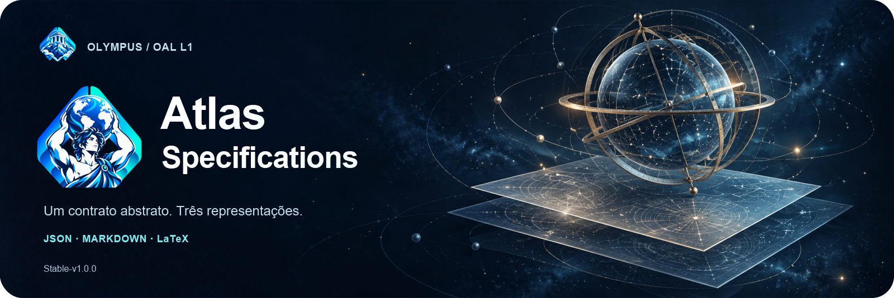
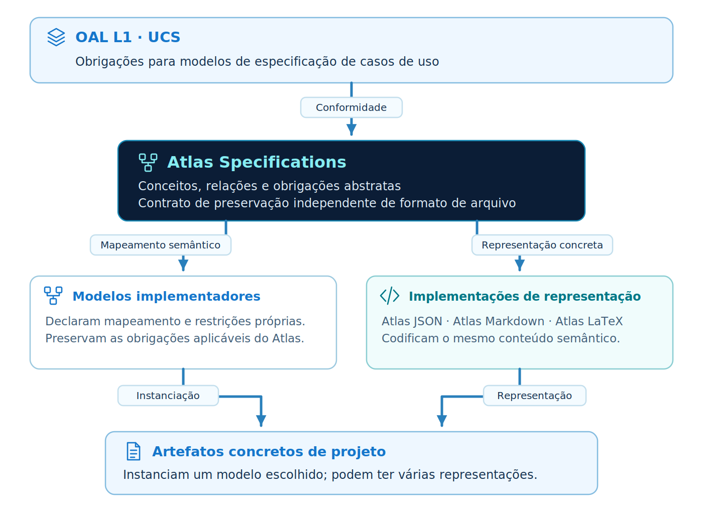
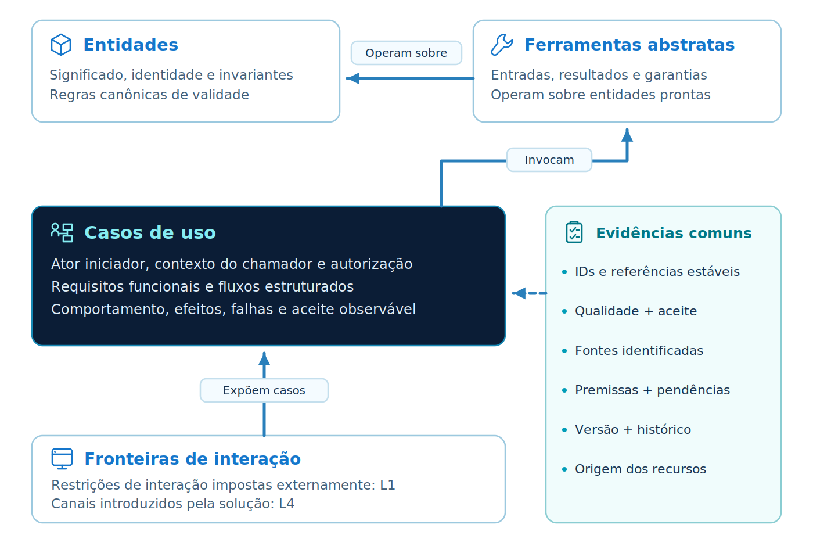
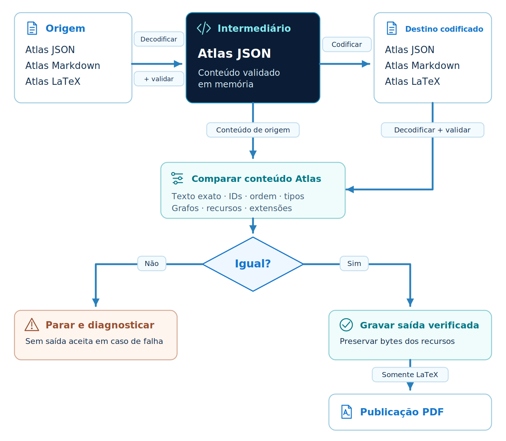

<p align="center"></p>

<p align="center"><strong>Atlas Specifications Stable-v1.0.0 · OAL L1 / UCS</strong></p>

[English](README.md) · Português brasileiro

# Atlas Specifications

**Atlas Specifications é um modelo abstrato para escrever especificações de casos de uso no L1 do OAL (UCS).** Ele conecta escopo, atores e permissões, entidades e regras, contratos de comportamento, dependências, critérios de aceite e as evidências de cada afirmação. Outros modelos podem implementar ou especializar Atlas mediante um mapeamento explícito de seus conceitos e obrigações.

Parte do ecossistema **Olympus**, Atlas oferece **Atlas JSON**, **Atlas Markdown** e **Atlas LaTeX**: três representações da mesma especificação. Um tradutor Python valida e converte seu conteúdo; o LaTeX pode então produzir um PDF para leitura e compartilhamento. O projeto inclui documentos iniciais equivalentes, exemplos completos e uma skill portátil para agentes de IA.

Este README é a apresentação ilustrada. O [manual da edição](versioning/Stable-v1.0.0/README.pt-br.md) concentra as regras e os contratos textuais detalhados. O inglês é normativo; o português é sua tradução.

A edição Stable define o contrato 1.0.0. Sua baseline OAL está fixada com os bytes originais na [correspondência da edição](versioning/Stable-v1.0.0/README.pt-br.md#oal-conformance). O escopo de verificação e o estado da entrega estão registrados no [relatório da release](versioning/Stable-v1.0.0/verification/RELEASE.md).

## Sumário

- [Atlas e OAL](#atlas-and-oal)
- [Conteúdo da especificação](#specification-content)
- [Representações e tradução](#translation)
- [Início rápido](#quick-start)
- [Versões](#versions)
- [Skill para IA](#ai-skill)
- [Exemplos](#examples)
- [Organização do repositório](#repository-organization)
- [Perguntas frequentes](#faq)
- [Autoria e licença](#authorship)

<a id="atlas-and-oal"></a>
## Atlas e OAL

<p align="center"></p>

[OAL — Open Analysis Layers](https://github.com/CodeVaultCommunity/OAL-Open-Analysis-Layers) define responsabilidades para modelos reutilizáveis em cada camada de desenvolvimento. Atlas usa **OAL Stable-v1.0.0** como referência para **L1 · Use Case Specification**, tornando explícito o comportamento desejado antes da escolha de organização de código e mecanismos de interação.

O diagrama distingue o metamodelo OAL, o modelo abstrato Atlas, modelos que implementam essa abstração e artefatos concretos de projetos. Uma especificação pode ter diversas representações em arquivos sem se tornar vários modelos. Um modelo implementador declara como preserva conceitos e invariantes de Atlas.

Atlas cobre o escopo L1 declarado. Não fornece as camadas seguintes do OAL nem um engine de derivação entre camadas. O [guia de conformidade](versioning/Stable-v1.0.0/README.pt-br.md#conformance) identifica baseline, mapeamento, evidências e limites.

<a id="specification-content"></a>
## Conteúdo da especificação

<p align="center"></p>

Uma especificação conecta conceitos por identidades estáveis e referências explícitas. Regras compartilhadas têm uma única definição autoritativa. Um caso declara o que deve acontecer, sob quais condições, para quais atores e com quais resultados e falhas.

| Parte | O que registra |
| --- | --- |
| **Contexto e atores** | Objetivos, escopo, vocabulário, papéis e contexto de autorização. |
| **Entidades e regras** | Dados, relações, estados válidos, validações canônicas e propriedade de regras. |
| **Ferramentas abstratas** | Capacidades, entradas, resultados, efeitos e garantias, sem prescrever mecanismos. |
| **Casos de uso** | Gatilhos, permissões, condições, requisitos, dependências, fluxos e critérios de aceite. |
| **Fronteiras e recursos** | Restrições externas classificadas, referências ou ilustrações, grafos e arquivos catalogados. |
| **Evidências e evolução** | Fontes, fatos, requisitos desejados, premissas, decisões, pendências, revisões e rastreabilidade. |

As [regras de referência](versioning/Stable-v1.0.0/README.pt-br.md#reference-rules) detalham essas obrigações. Elas distinguem informação confirmada de premissas e mantêm escolhas de interação da solução separadas de requisitos impostos externamente.

<a id="translation"></a>
## Representações e tradução

| Representação | Uso típico | Ponto de partida |
| --- | --- | --- |
| **Atlas JSON** | Autoria estruturada, validação e automação. | [Schema e guia](versioning/Stable-v1.0.0/implementations/json/README.pt-br.md) · [Documento inicial](versioning/Stable-v1.0.0/implementations/json/starter.atlas.json) |
| **Atlas Markdown** | Leitura e revisão de especificações no repositório. | [Guia do perfil](versioning/Stable-v1.0.0/implementations/markdown/README.pt-br.md) · [Documento inicial](versioning/Stable-v1.0.0/implementations/markdown/starter.atlas.md) |
| **Atlas LaTeX** | Diagramação e publicação PDF. | [Guia do perfil](versioning/Stable-v1.0.0/implementations/latex/README.pt-br.md) · [Documento inicial](versioning/Stable-v1.0.0/implementations/latex/starter.atlas.tex) |

Um **schema** verifica a estrutura; um **documento inicial (starter)** é um arquivo para copiar e preencher; um **exemplo** demonstra contratos preenchidos. Os três documentos iniciais carregam rascunhos equivalentes. Markdown e LaTeX seguem perfis controlados, com registros textuais autoritativos e apêndices estruturais, portanto arquivos `.md` e `.tex` arbitrários não são automaticamente instâncias Atlas.

<p align="center"></p>

O tradutor suporta as **seis direções entre os três perfis**. Ele decodifica e valida a origem, produz o destino, depois decodifica essa saída e compara todo o conteúdo `atlas` recuperado antes de gravar. Markdown ↔ LaTeX usa o conteúdo JSON validado em memória como representação intermediária.

A preservação abrange texto autoral, estrutura, identidades, referências e dados de extensão suportados, sem exigir bytes de arquivo ou diagramação idênticos. Recursos usam o contrato separado de empacotamento. PDF é uma publicação compilada e não é aceito como entrada reversível. Consulte as [regras detalhadas de tradução](versioning/Stable-v1.0.0/README.pt-br.md#translation) e o [guia da CLI](versioning/Stable-v1.0.0/translator/README.pt-br.md).

<a id="quick-start"></a>
## Início rápido

Use **Python 3.11 ou posterior**. Depois de extrair o repositório, execute a partir da raiz:

```bash
cd versioning/Stable-v1.0.0
python -m venv .venv
# POSIX: source .venv/bin/activate
# PowerShell: .venv\Scripts\Activate.ps1
python -m pip install .
python translator/atlas_translate.py formats
python translator/atlas_translate.py validate implementations/json/starter.atlas.json
python translator/atlas_translate.py convert implementations/json/starter.atlas.json --from json --to markdown -o work/specification.atlas.md
```

O último comando cria um rascunho Markdown em `work/`. Para autoria estruturada, copie o documento inicial JSON para sua pasta de trabalho, substitua identidade e autoria e preencha-o com necessidades reais antes de validar e converter. O comando instalado `atlas-spec` oferece a mesma interface.

Um documento inicial é um rascunho válido, com coleções de domínio vazias e questões pendentes explícitas. Passar na validação não estabelece uma especificação completa ou aprovada. Consulte o [setup detalhado](versioning/Stable-v1.0.0/README.pt-br.md#quick-start) para autoria, recursos e publicação, e o [guia de verificação](versioning/Stable-v1.0.0/README.pt-br.md#verification) para testes.

<a id="versions"></a>
## Versões

| Edição | Status | Notas da versão | Regras de referência | Guia de verificação | Guia de conformidade |
| --- | --- | --- | --- | --- | --- |
| Stable-v1.0.0 | Edição Stable | [English](versioning/Stable-v1.0.0/README.md#release-notes) · [Português](versioning/Stable-v1.0.0/README.pt-br.md#release-notes) | [English](versioning/Stable-v1.0.0/README.md#reference-rules) · [Português](versioning/Stable-v1.0.0/README.pt-br.md#reference-rules) | [English](versioning/Stable-v1.0.0/README.md#verification) · [Português](versioning/Stable-v1.0.0/README.pt-br.md#verification) | [English](versioning/Stable-v1.0.0/README.md#conformance) · [Português](versioning/Stable-v1.0.0/README.pt-br.md#conformance) |
| Alpha-v0.1.0 | Histórica · preservada | [English](versioning/Alpha-v0.1.0/README.md#release-notes) · [Português](versioning/Alpha-v0.1.0/README.pt-br.md#release-notes) | [English](versioning/Alpha-v0.1.0/README.md#reference-rules) · [Português](versioning/Alpha-v0.1.0/README.pt-br.md#reference-rules) | [English](versioning/Alpha-v0.1.0/README.md#verification) · [Português](versioning/Alpha-v0.1.0/README.pt-br.md#verification) | [English](versioning/Alpha-v0.1.0/README.md#conformance) · [Português](versioning/Alpha-v0.1.0/README.pt-br.md#conformance) |

A edição mantém tradutor, dependências, testes, exemplos e skill próprios. O [guia de versionamento](versioning/Stable-v1.0.0/README.pt-br.md#versioning) distingue versões de modelo/perfis e pacote da revisão de um documento. A conversão preserva essas identidades; não é uma migração.

<a id="ai-skill"></a>
## Skill para IA

A [skill Atlas](versioning/Stable-v1.0.0/skills/atlas-specs/SKILL.md) é portátil e oferece os fluxos **criar/revisar**, **ler/auditar** e **converter/publicar**. Copie a pasta completa `skills/atlas-specs/` e siga suas instruções. Ela inclui referências, um documento inicial e o tradutor da mesma versão para uso independente. Agentes devem distinguir requisitos fornecidos de premissas e questões não resolvidas.

Para navegar pelo repositório e instalar a skill, consulte [AGENTS.md](AGENTS.md). [CLAUDE.md](CLAUDE.md) fornece o ponto de entrada correspondente para fluxos com Claude.

`skills/build.py` é um auxiliar de manutenção. Ele sincroniza a skill após alterações na documentação canônica, schemas, estilos ou código do tradutor; `--check` detecta divergências sem gravar. **Usar a skill distribuída não exige executar o construtor.** O [manual da edição](versioning/Stable-v1.0.0/README.pt-br.md#ai-skill) explica o pacote gerado.

<a id="examples"></a>
## Exemplos

| Exemplo | O que explorar |
| --- | --- |
| [Solicitação mínima](versioning/Stable-v1.0.0/examples/minimal/README.pt-br.md) | Um caso, validação de entidade, permissões e ilustrações empacotadas. |
| [Composição](versioning/Stable-v1.0.0/examples/composition/README.pt-br.md) | Consulta/criação/cancelamento de reservas, casos compostos e resultados de persistência. |
| [Quadro de tarefas](versioning/Stable-v1.0.0/examples/task-board/README.pt-br.md) | Criar/concluir/listar tarefas, conflitos e vínculos entre necessidades sintéticas, requisitos e aceite. |

Cada um inclui JSON, Markdown, LaTeX e PDF. São especificações didáticas, com premissas e metas propostas identificadas. O [guia dos exemplos](versioning/Stable-v1.0.0/examples/README.pt-br.md) descreve fontes e comandos de reconstrução/verificação.

<a id="repository-organization"></a>
## Organização do repositório

| Local | Finalidade |
| --- | --- |
| READMEs da raiz | Apresentação ilustrada, início rápido, navegação por versões e créditos. |
| [CONTENT-SHA256.json](CONTENT-SHA256.json) | Tamanhos e SHA-256 exatos de todos os arquivos distribuídos, exceto o próprio inventário. |
| [docs/releasing.pt-br.md](docs/releasing.pt-br.md) e `scripts/` | Verificação do repositório, empacotamento limpo e publicação opcional. |
| [`assets/`](assets/README.pt-br.md) | Banners, diagramas, ambos os ícones e fontes editáveis/reproduzíveis compartilhados. |
| [`versioning/Stable-v1.0.0/`](versioning/Stable-v1.0.0/README.pt-br.md) | Manual textual detalhado e edição completa utilizável de forma independente. |

A edição mantém os recursos de runtime e exemplos necessários à sua operação. Copiar essa pasta é suficiente para usá-la e testá-la; tradutor e skill não dependem das imagens da raiz. Os [metadados de citação](CITATION.cff) estão disponíveis na raiz.

<a id="faq"></a>
## Perguntas frequentes

<details><summary>Atlas JSON é o modelo abstrato?</summary>

Atlas define conceitos semânticos independentemente da notação. JSON é uma representação e o formato intermediário do tradutor de referência. Outro modelo implementador pode usar uma estrutura diferente, com mapeamento explícito de preservação.

</details>

<details><summary>A validação estabelece completude semântica?</summary>

A validação verifica invariantes do perfil. Um revisor ainda avalia escopo, fontes, autorização, comportamento, falhas, aceite e pendências. O guia de conformidade mantém essas avaliações distintas.

</details>

<details><summary>O tradutor pode converter outro modelo L1 automaticamente?</summary>

Ele converte os três perfis Atlas. Outro modelo exige mapeamento, domínio suportado e contrato de preservação próprios. Compartilhar responsabilidades do OAL L1 não define um tradutor por si só.

</details>

<a id="authorship"></a>
## Autoria e licença

Atlas Specifications foi idealizado e desenvolvido por **Douglas de Oliveira Alkimim**. Distribuído sob a [licença MIT](LICENSE).

<p><strong>Douglas de Oliveira Alkimim</strong><br><a href="https://github.com/douglas-alkimim">GitHub</a> · <a href="https://www.linkedin.com/in/douglas-alkimim/">LinkedIn</a></p>
<br clear="all">
