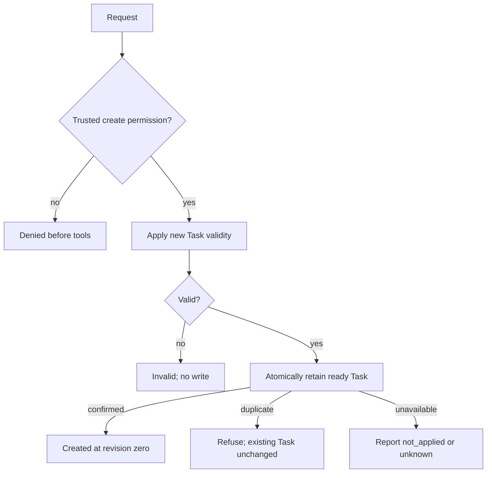
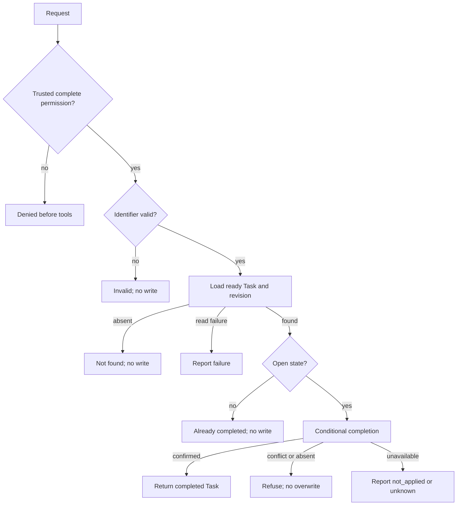
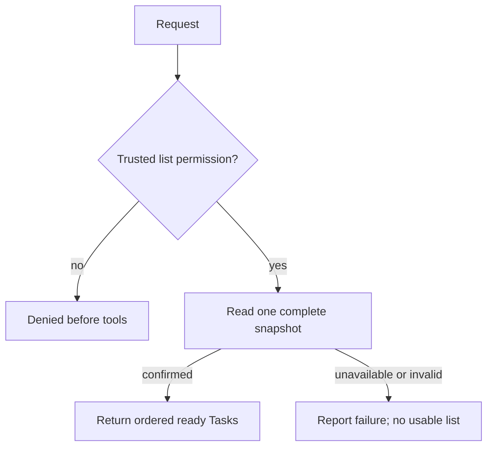

# Task board: the main Atlas reference

[Português](README.pt-br.md) · [Examples](../README.md) · [Synthetic brief](needs.md) · [Traceability](traceability.md)

Read this example to see one L1 specification expressed as [Atlas JSON](example.atlas.json), [Atlas Markdown](example.atlas.md), and [Atlas LaTeX](example.atlas.tex). The [PDF](example.atlas.pdf) is the compiled LaTeX publication. The three editable representations have equal Atlas content; their formatting syntax differs.

## Case contracts

| Identity | Goal and inputs | Success | Refusals and failures |
| --- | --- | --- | --- |
| `UC-TASK-CREATE` | Remember a task from exact identifier and title. | One ready open Task retained at revision zero. | Denied caller; invalid candidate; duplicate identifier; storage failure with `not_applied` or `unknown`. |
| `UC-TASK-COMPLETE` | Complete the existing Task identified by exact identifier. | Status completed and revision incremented once; identifier/title preserved. | Denied caller; invalid identifier; confirmed absence; already completed; concurrent version conflict; storage failure. |
| `UC-TASK-LIST` | Observe the board selected in trusted context. No business input. | Complete ordered snapshot; an empty list is a valid confirmed result. | Denied caller; unavailable store; invalid stored state. No partial or falsely empty success. |

All three cases require a concrete authenticated caller resolved to the board-member role, the case-specific permission and the selected board. A role name in request data is not authorization evidence. Actor, caller context and a human accountable for a derivation are distinct concepts.

## Create flow

## Complete flow

## List flow

These README diagrams are readable summaries. The instance's structured graphs preserve stable IDs, full edge labels, calls and RF associations. The LaTeX publication contains views of those exact graphs.

## Entities, persistence and uncertainty

`ENT-TASK` owns field and state-transition validity. `TOL-TASK-STORE` exposes four abstract capabilities: create, load, complete and list. Cases apply entity rules where necessary, then pass ready entities to tools. Tools can check external operation conditions such as identifier uniqueness and observed revision; they do not duplicate established entity invariants.

A confirmed write has an explicit retention guarantee. A failure before application may guarantee `not_applied`. A lost confirmation can leave the outcome `unknown`. The case must retain that uncertainty, never equate a failed response with proof of no write, and never retry automatically. This is a behavioral contract; it chooses no transaction library, database or network protocol.

## Identity and revisions

- **Valid reference:** `UC-TASK-COMPLETE.entities[0].entity = "ENT-TASK"` resolves to the single entity definition.
- **Invalid reference:** changing that value to `"ENT-UNKNOWN"` must fail reference validation; a converter cannot silently create the missing entity.
- **Versioned content change:** changing the task title policy requires a new document `revision`, an explicit history entry and review of affected cases/acceptance. Stable IDs remain stable for the same concepts. Changing a representation does not change the document revision.
- **Replacement/removal:** preserve an explicit history mapping and update all references. Never reuse an old stable ID for an unrelated concept or delete a still-referenced definition.

The examples are not a task application or a demonstration of L2–L4 implementation. Their acceptance criteria are obligations to verify in a future implementation. The [brief](needs.md) and source records disclose the synthetic origin of every product rule, avoiding any claim of actual stakeholder approval.

## Author

Douglas de Oliveira Alkimim.
