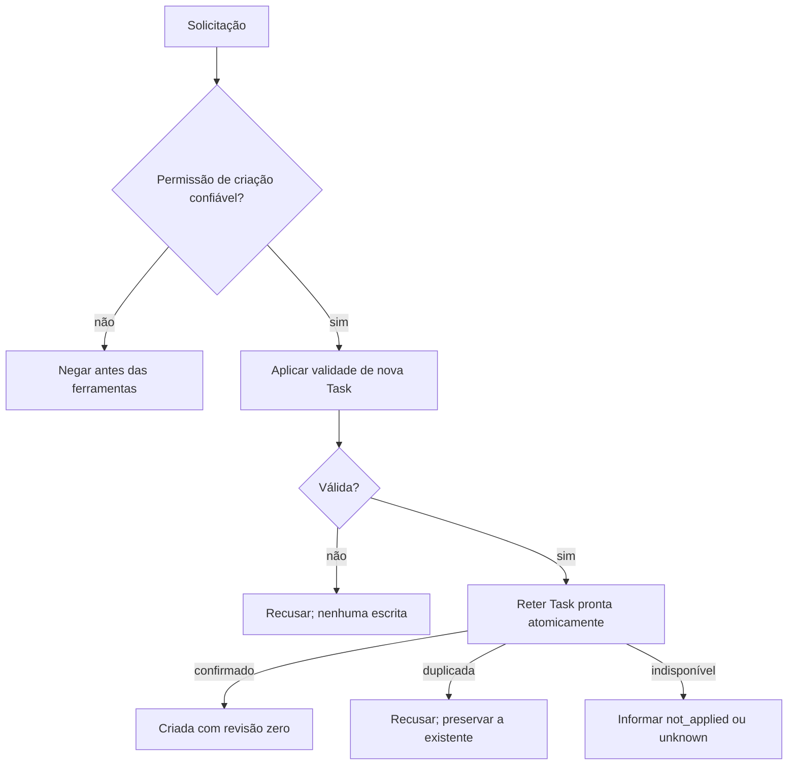
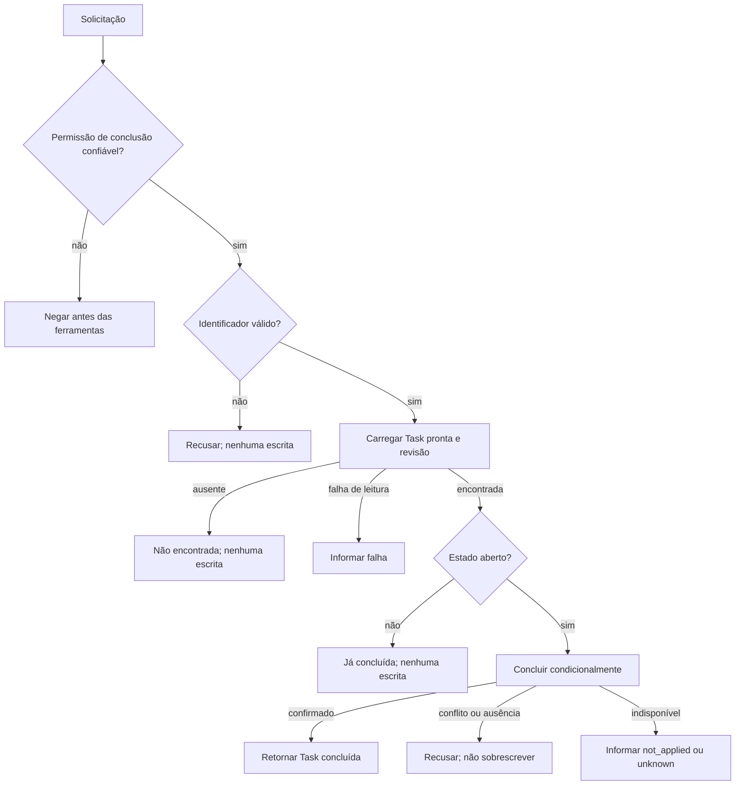
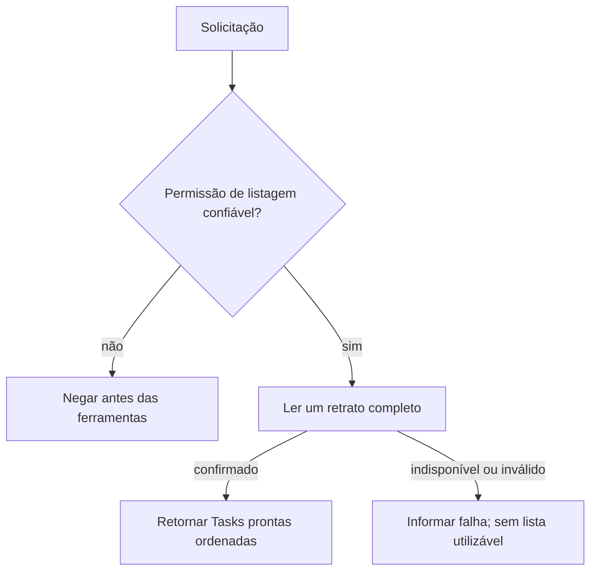

# Quadro de tarefas: referência principal do Atlas

[English](README.md) · [Exemplos](../README.pt-br.md) · [Base sintética](needs.md) · [Rastreabilidade](traceability.md)

Este exemplo mostra uma especificação de L1 expressa em [Atlas JSON](example.atlas.json), [Atlas Markdown](example.atlas.md) e [Atlas LaTeX](example.atlas.tex). O [PDF](example.atlas.pdf) é a publicação compilada do LaTeX. As três representações editáveis transportam conteúdo Atlas igual; suas sintaxes de formatação diferem.

## Contratos dos casos

| Identidade | Objetivo e entradas | Sucesso | Recusas e falhas |
| --- | --- | --- | --- |
| `UC-TASK-CREATE` | Registrar uma tarefa a partir de identificador exato e título. | Uma Task pronta, aberta e retida com revisão zero. | Chamador sem autorização; dados inválidos; identificador duplicado; falha de armazenamento com `not_applied` ou `unknown`. |
| `UC-TASK-COMPLETE` | Concluir a Task existente identificada pela entrada. | Estado concluído e revisão incrementada uma vez; identificador e título preservados. | Sem autorização; identificador inválido; ausência confirmada; já concluída; conflito de versão; falha de armazenamento. |
| `UC-TASK-LIST` | Observar o quadro selecionado no contexto confiável. Sem entrada de negócio. | Retrato completo e ordenado; lista vazia é um resultado confirmado válido. | Sem autorização; armazenamento indisponível; estado armazenado inválido. Não há sucesso parcial ou falsamente vazio. |

Os três casos exigem um chamador autenticado, concreto, resolvido como membro do quadro, com a permissão específica do caso e o quadro selecionado. Um nome de papel enviado nos dados não é prova de autorização. Ator, contexto do chamador e pessoa responsável por uma derivação são conceitos distintos.

## Fluxo de criação

## Fluxo de conclusão

## Fluxo de listagem

Os diagramas deste README são resumos legíveis. Os grafos estruturados das instâncias preservam IDs estáveis, rótulos completos, chamadas e associações com RFs. A publicação LaTeX contém visões desses grafos exatos.

## Entidades, persistência e incerteza

`ENT-TASK` possui a validade dos campos e das transições. `TOL-TASK-STORE` expõe quatro capacidades abstratas: criar, carregar, concluir e listar. Os casos aplicam regras da entidade quando necessário e entregam entidades prontas às ferramentas. As ferramentas podem verificar condições externas da operação, como unicidade e revisão observada; não duplicam invariantes já estabelecidas da entidade.

Uma escrita confirmada oferece garantia explícita de retenção. Uma falha anterior à aplicação pode garantir `not_applied`. Uma confirmação perdida pode deixar o resultado `unknown`. O caso preserva essa incerteza: uma resposta de falha não comprova ausência de escrita e não autoriza repetição automática. O contrato não escolhe biblioteca de transações, banco de dados ou protocolo.

## Identidade e revisões

- **Referência válida:** `UC-TASK-COMPLETE.entities[0].entity = "ENT-TASK"` resolve para a única definição da entidade.
- **Referência inválida:** trocar o valor por `"ENT-UNKNOWN"` deve falhar na validação; o conversor não pode criar silenciosamente a definição ausente.
- **Alteração versionada:** mudar a política do título exige nova `revision` do documento, histórico explícito e revisão dos casos e critérios afetados. Os IDs dos mesmos conceitos permanecem estáveis. Traduzir uma representação não muda a revisão documental.
- **Substituição ou remoção:** registrar o mapeamento no histórico e atualizar todas as referências. Não reutilizar um ID antigo para um conceito diferente nem excluir uma definição ainda referenciada.

O exemplo não implementa uma aplicação de tarefas nem demonstra L2–L4. Seus critérios de aceite são obrigações para uma implementação futura. A [base sintética](needs.md) e os registros de origem tornam explícita a natureza didática das regras, sem alegar aprovação real de partes interessadas.

## Autoria

Douglas de Oliveira Alkimim.

[Demonstração versionada: revisões Stable 2 e 3](revisions/README.md), com motivo, delta, impacto e teste específico.

`SRC-TASK-OAL` conserva a fonte Alpha histórica da autoria original; não é relabelada. A alegação atual do modelo Atlas usa a [baseline Stable revisada](../../verification/OAL-CORRESPONDENCE.md), cujas cláusulas relevantes foram comparadas com essa origem.
